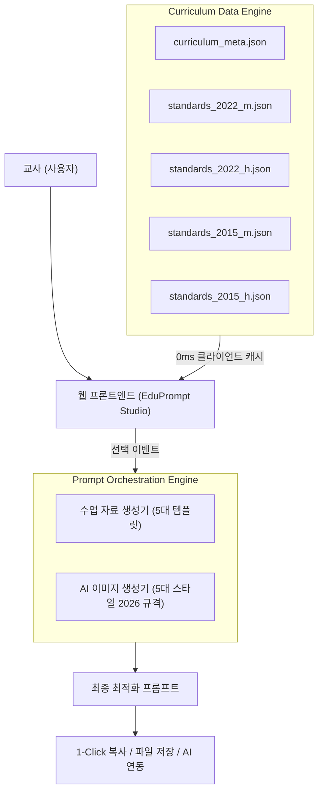

# 🎓 EduPrompt Studio (에듀 프롬프트 오케스트레이터)

> **2022·2015 개정 교육과정 성취기준 및 성취수준 기반 교과별 수업 자료 & AI 이미지 프롬프트 빌더**

교사가 수업을 설계할 때 가장 핵심이 되는 교육부 고시 성취기준과 5단계(A~E) 성취수준을 원클릭으로 탐색하고, 이를 바탕으로 고품질 수업 활동지, 수행평가 과제, 토의 발문, 그리고 교과서 맞춤형 AI 이미지 생성 프롬프트를 직관적인 버튼 인터랙션으로 손쉽게 생성할 수 있는 교원 전용 프롬프트 오케스트레이션 도구입니다.

---

## ✨ 핵심 기능

### 1. 🎨 은은한 파스텔 톤 & 모던 비주얼 UI
- **Soft Pastel Aesthetics**: 눈의 피로를 최소화하는 소프트 라벤더, 세이지 민트, 스카이 블루, 피치 코럴, 은은한 크림 화이트의 정밀한 조화
- **Glassmorphism & Micro-Interactions**: 반투명 글래스 패널, 미세한 보더라인, 직관적인 호버/선택 애니메이션
- **반응형 디자인**: PC, 태블릿, 모바일 전 기기 해상도 완벽 지원

### 2. 🔘 단계별 버튼(칩) 형식의 프롬프트 빌더
- **[Step 1] 교육과정 & 학교급**: 2022 개정 / 2015 개정, 중학교 / 고등학교 원클릭 전환
- **[Step 2] 교과군 선택**: 국어, 수학, 영어, 사회, 과학, 체육, 음악, 미술, 기술·가정, 정보, 한문, 제2외국어, 교양 등 전 교과군 지원
- **[Step 3] 과목 선택**: 선택한 교과군에 따라 개설 과목 목록 실시간 동적 필터링
- **[Step 4] 성취기준 선택**: 성취기준 코드 및 내용 카드 제공, 실시간 키워드 검색 지원
- **[Step 5] 성취수준 선택**:
  - **2022 개정**: `[A (심화·종합)]`, `[B (우수·적용)]`, `[C (기본·이해)]`, `[D (보충)]`, `[E (기초)]`
  - **2015 개정**: `[상 (심화)]`, `[중 (기본)]`, `[하 (보충)]`
- **[Step 6] 프롬프트 모드 & 스타일 선택**:
  - 📝 **수업 자료 생성**: 
    1. 탐구 활동지 (도입-전개-정리-발문 구조)
    2. 실생활 연계 과제 & 수행평가 프로젝트
    3. 생각열기 토의·토론 발문
    4. 개념 형성평가 & 피드백 퀴즈
    5. 성취수준 기반 학교생활기록부 교과세특 예시 문구
  - 🎨 **수업 이미지 제작 (2026 Imagen 3 / Midjourney / DALL-E 3 규격)**:
    1. 교과서 감성 일러스트 (Soft Watercolor & Clean Line Art)
    2. 3D 입체 다이어그램 (Isometric Clay & Glass Render)
    3. 실사 다큐멘터리 (National Geographic Style Macro Photography)
    4. 학생 친화형 웹툰/카툰 (Modern Friendly Cartoon Character)
    5. 미니멀 인포그래픽 (Minimalist Educational Infographic)

### 3. ⚡ 사용자 편의 기능
- **실시간 프롬프트 뷰어 & 인라인 편집기**: 생성된 프롬프트를 화면에서 바로 수정 가능
- **1-Click 클립보드 복사**: 클릭 즉시 복사 및 플로팅 토스트 피드백
- **원클릭 AI 연동**: ChatGPT, Claude, Google Gemini 바로가기 버튼 제공
- **파일 다운로드**: 텍스트(.txt) 및 마크다운(.md) 파일로 즉시 저장

---

## 🏗️ 시스템 아키텍처

---

## 🚀 배포 환경
- **호스팅**: Vercel Edge Network
- **데이터 소스**: 교육부·한국교육과정평가원 학생평가지원포털(STAS) 및 에듀넷·티클리어 공식 배포 2015·2022 개정 성취기준·평가기준·성취수준 통합 DB
